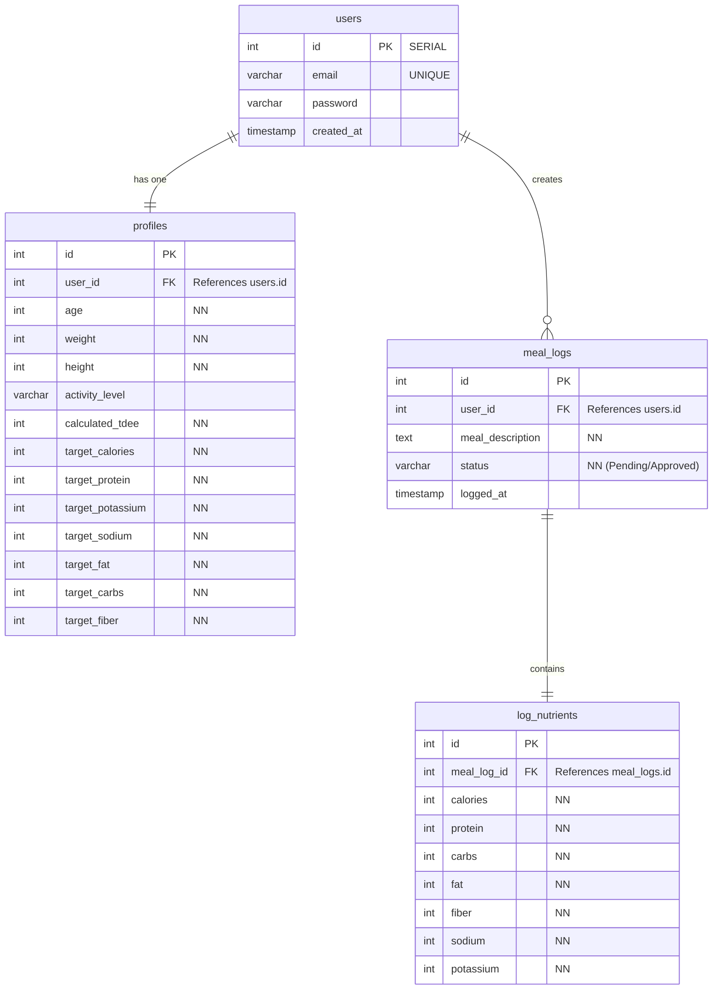

# 🌱 Nourish

Nourish is a useful tool for the everyday individual looking to take charge of their food journey with realistic data. Accomplished through a simple chat, Gemini AI converts meal entries and photos into accurate nutritional estimates. It allows the user to approve estimates and monitor data without having to spend a fortune. If you're searching for a tool that brings genuine encouragement to your health goals while providing clear and reliable data, Nourish is the solution.

## Project Directory

```text
nourish/
├── .env                       # Environment variables (DB URI, JWT secret, Gemini API key)
├── package.json               # Dependencies & scripts
├── vite.config.js             # Vite configuration (for React frontend)
│
└── src/
    ├── api/                   # API route handlers / Axios or Fetch wrappers
    ├── auth/                  # Client/server auth utilities (JWT, token storage)
    ├── components/            # React components
    │   ├── common/            # Reusable UI (Buttons, Inputs, Cards)
    │   ├── layout/            # Layout wrappers (Navbar, Header, Sidebar)
    │   ├── chat/              # AI Chat components
    │   ├── dashboard/         # Macros/Analytics components
    │   └── auth/              # Login & Registration forms
    ├── db/
    │   ├── schema.sql         # SQL migration scripts (CREATE TABLE statements)
    │   └── queries/           # SQL query functions (users, profiles, meal_logs)
    ├── middleware/            # Express backend middleware (Auth verification, Error handling)
    ├── services/              # Business logic & external API integrations (e.g., Gemini AI service)
    ├── utils/                 # Helper functions (TDEE calculation math, date formatters)
    ├── App.jsx                # Main React App component
    ├── main.jsx               # React DOM root entry point
    ├── server.js              # Express backend server entry point
    └── App.css              # Global styles
```

## ERD


